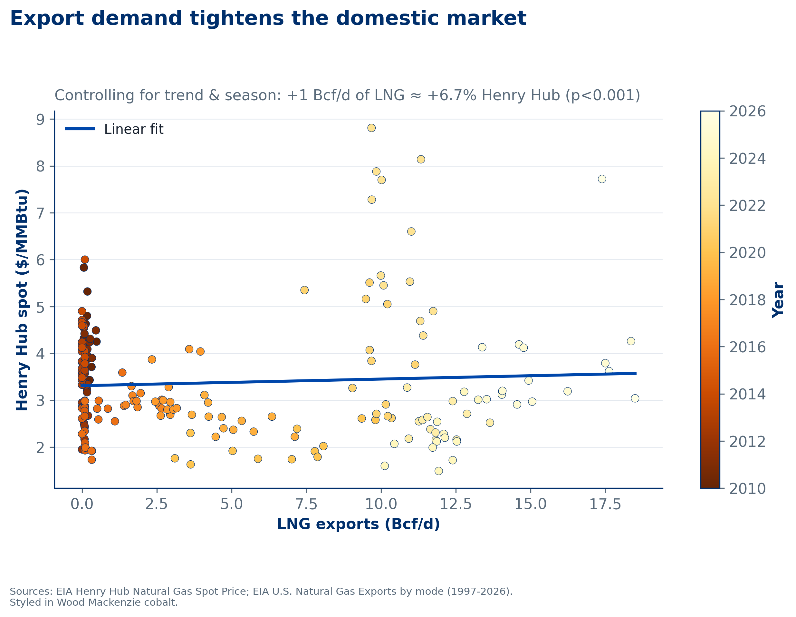

::: {.callout-note appearance="simple"}
Independent portfolio project on gas-market fundamentals.
:::

## Question

From Sabine Pass's first cargo in 2016 to 2025, U.S. LNG exports grew from about 0.5 to 15 Bcf/d, making the U.S. the world's largest LNG exporter. **Did that new export demand push domestic Henry Hub prices up?**

## Data

- [EIA Henry Hub spot price](https://www.eia.gov/dnav/ng/hist/rngwhhdm.htm), monthly
- [EIA natural gas exports by mode](https://www.eia.gov/dnav/ng/xls/NG_MOVE_EXPC_S1_M.xls) (LNG and pipeline)
- Terminal first-cargo dates, hand-coded from operator announcements

The panel covers 351 months, January 1997 to March 2026.

## Method

1. An **interrupted time series** around Sabine Pass's first cargo (February 2016).
2. A **price ~ LNG exports regression** (2010 onwards) with trend and seasonal controls and **Newey-West (HAC) standard errors** for serial correlation.

## Key finding

Two things are true at once:

- **On the margin, exports raise prices.** Each additional 1 Bcf/d of LNG exports is associated with a **+6.7%** Henry Hub price (HAC SE 0.016, p ≈ 0.0001, n = 195).
- **On average, prices still fell,** from \$4.57 to \$3.23/MMBtu between the pre-export and export eras. Shale supply grew faster than export demand.

## Limitations and next steps

This is a reduced-form view, not a structural model: exports, prices and production are determined together. Next I'd add dry-gas production, storage levels and heating-degree days, and test lead-lag structure with a VAR.

## Code

<!-- Add a GitHub link once the repo is public. -->
