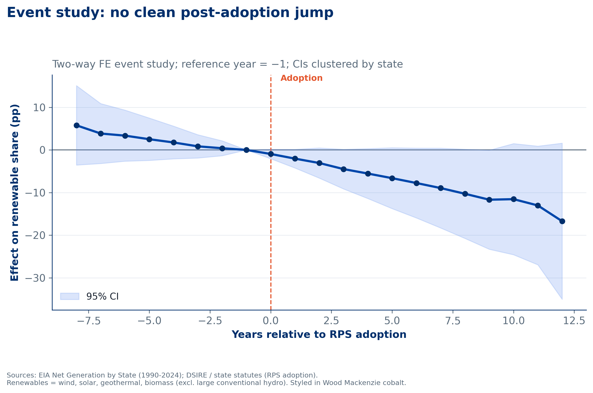

::: {.callout-note appearance="simple"}
Independent portfolio project applying causal panel methods from political science to power-market policy.
:::

## Question

29 U.S. states adopted binding Renewable Portfolio Standards (RPS). **How much of the U.S. renewable build-out did those mandates cause, compared with resource quality and falling wind and solar costs?**

## Data

| Source | Description |
|---|---|
| [EIA](https://www.eia.gov/electricity/data/state/) | Net generation by state and fuel source |
| [DSIRE](https://dsireusa.org/resources/detailed-summary-maps/) | RPS adoption year and binding status (hand-coded) |

The final panel has 1,428 state-years: 51 states, 1997–2024.

## Method

- **Two-way fixed effects** (state + year) with state-clustered standard errors, using `fixest`.
- **Staggered difference-in-differences event study**, with t = −1 as the reference year.
- Robustness checks across three outcomes: new renewables, renewables including hydro, and wind only.

## Key finding

A binding RPS shows **no robust positive effect** on renewable generation share. The TWFE estimate is −1.8 percentage points (SE 1.97, p = 0.37), and the wind-only and hydro-inclusive outcomes give the same answer.

RPS states led early (3.9% vs 1.5% renewable share in 1997), but non-RPS states had caught up by 2024 (18.4% vs 19.6%). The build-out seems to come from wind and solar economics and resource quality more than from the mandates.

## Limitations and next steps

Standard TWFE can be biased under staggered adoption, so the next step is **Callaway & Sant'Anna or Sun & Abraham** estimators. I'd also replace the binary mandate with **RPS stringency** (required percentage and target year) and add resource-potential, retail-price and political-control covariates.

## Code

<!-- Add a GitHub link once the repo is public. -->
